# Lab 06 — OSPF Single-Area

## 1. Project Overview

This project demonstrates the design, configuration, and verification of Open Shortest Path First (OSPFv2) in a small enterprise network using Cisco Packet Tracer 8.2.2.

The topology consists of three routers connected in a linear arrangement. R1 provides connectivity for the Head Office LAN, R3 provides connectivity for the Branch Office LAN, and R2 acts as the intermediate transit router.

All three routers participate in a single OSPF backbone area (Area 0). OSPF dynamically establishes neighbor relationships, exchanges link-state information, and installs routes to remote networks.

The laboratory covers IPv4 addressing, OSPF configuration, Router ID assignment, neighbor formation, dynamic route advertisement, routing-table analysis, interface-cost inspection, and end-to-end connectivity testing.

## 2. Scenario

An organization operates two user LANs at separate sites.

The Head Office LAN is connected to R1, while the Branch Office LAN is connected to R3. R2 provides transit connectivity between the two edge routers.

Instead of manually configuring static routes to every remote network, the routers use OSPF to exchange routing information dynamically within Area 0.

The network consists of:

- A Head Office LAN connected to R1.
- An intermediate router R2 providing transit connectivity.
- A Branch Office LAN connected to R3.
- Two Ethernet transit links between the three routers.

## 3. Objectives

- Build a three-router network using Cisco Packet Tracer.
- Configure IPv4 addressing on router interfaces.
- Assign unique OSPF Router IDs.
- Enable OSPF process 1 in Area 0.
- Establish and verify OSPF neighbor relationships.
- Advertise LAN and transit networks through OSPF.
- Verify dynamically learned routes in routing tables.
- Inspect OSPF interface costs and routing metrics.
- Test bidirectional connectivity between the two LANs.
- Document the network configuration and verification results.
- Maintain technical evidence through configuration files and screenshots.

## 4. Requirements

### Software

| Software | Version |
|---|---|
| Cisco Packet Tracer | 8.2.2 |

### Devices

| Device | Model | Quantity | Role |
|---|---|---:|---|
| R1, R2, R3 | Cisco 1941 | 3 | OSPF routers |
| S1, S2 | Cisco 2960-24TT | 2 | Layer 2 access switches |
| PC1, PC2 | PC-PT | 2 | End devices |

### Networking Knowledge

- IPv4 addressing and subnetting
- Basic router and switch configuration
- Routing-table interpretation
- OSPF fundamentals
- Router IDs, OSPF areas, neighbors, and cost

## 5. Network Architecture

The network is divided into three logical sections:

- **Head Office:** PC1 and switch S1 connect to R1 on `192.168.10.0/24`.
- **OSPF Backbone:** R1, R2, and R3 are interconnected through two transit networks in Area 0.
- **Branch Office:** R3 connects switch S2 and PC2 on `192.168.30.0/24`.

### Network Topology

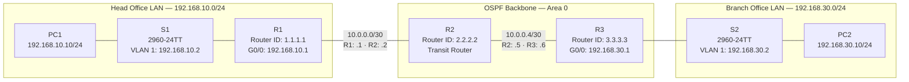

### Topology Evidence

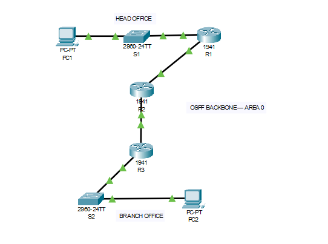

## 6. Device Inventory

| Device | Model | Function |
|---|---|---|
| R1 | Cisco 1941 | Head Office gateway and OSPF router |
| R2 | Cisco 1941 | Intermediate transit router and OSPF router |
| R3 | Cisco 1941 | Branch Office gateway and OSPF router |
| S1 | Cisco 2960-24TT | Head Office access switch |
| S2 | Cisco 2960-24TT | Branch Office access switch |
| PC1 | PC-PT | Head Office client |
| PC2 | PC-PT | Branch Office client |

## 7. IP Addressing Plan

### Router Interfaces

| Device | Interface | IPv4 Address | Subnet Mask |
|---|---|---|---|
| R1 | GigabitEthernet0/0 | `192.168.10.1` | `255.255.255.0` |
| R1 | GigabitEthernet0/1 | `10.0.0.1` | `255.255.255.252` |
| R2 | GigabitEthernet0/0 | `10.0.0.2` | `255.255.255.252` |
| R2 | GigabitEthernet0/1 | `10.0.0.5` | `255.255.255.252` |
| R3 | GigabitEthernet0/0 | `192.168.30.1` | `255.255.255.0` |
| R3 | GigabitEthernet0/1 | `10.0.0.6` | `255.255.255.252` |

### Switch Management Interfaces

| Device | Interface | IPv4 Address | Subnet Mask | Default Gateway |
|---|---|---|---|---|
| S1 | VLAN 1 | `192.168.10.2` | `255.255.255.0` | `192.168.10.1` |
| S2 | VLAN 1 | `192.168.30.2` | `255.255.255.0` | `192.168.30.1` |

### End Devices

| Device | Interface | IPv4 Address | Subnet Mask | Default Gateway |
|---|---|---|---|---|
| PC1 | FastEthernet0 | `192.168.10.10` | `255.255.255.0` | `192.168.10.1` |
| PC2 | FastEthernet0 | `192.168.30.10` | `255.255.255.0` | `192.168.30.1` |

### Transit Networks

| Link | Network | Usable Addresses | Broadcast Address |
|---|---|---|---|
| R1–R2 | `10.0.0.0/30` | `10.0.0.1`, `10.0.0.2` | `10.0.0.3` |
| R2–R3 | `10.0.0.4/30` | `10.0.0.5`, `10.0.0.6` | `10.0.0.7` |

Both transit networks use `/30` subnet masks, providing two usable IPv4 addresses per link.

## 8. Port Assignment

### Head Office — S1

| Switch Port | Connected Device | Device Interface |
|---|---|---|
| FastEthernet0/1 | PC1 | FastEthernet0 |
| FastEthernet0/24 | R1 | GigabitEthernet0/0 |

### Router Links

| Device A | Interface A | Device B | Interface B | Network |
|---|---|---|---|---|
| R1 | GigabitEthernet0/1 | R2 | GigabitEthernet0/0 | `10.0.0.0/30` |
| R2 | GigabitEthernet0/1 | R3 | GigabitEthernet0/1 | `10.0.0.4/30` |

### Branch Office — S2

| Switch Port | Connected Device | Device Interface |
|---|---|---|
| FastEthernet0/24 | R3 | GigabitEthernet0/0 |
| FastEthernet0/1 | PC2 | FastEthernet0 |

Both access switches use VLAN 1. No trunk links or additional VLANs are required for this laboratory.

## 9. OSPF Design and Configuration

### OSPF Parameters

| Parameter | Value |
|---|---|
| Routing Protocol | OSPFv2 |
| OSPF Process ID | `1` |
| OSPF Area | `0` |
| R1 Router ID | `1.1.1.1` |
| R2 Router ID | `2.2.2.2` |
| R3 Router ID | `3.3.3.3` |
| Expected Adjacencies | R1–R2 and R2–R3 |

The OSPF process ID is locally significant. Using the same process ID on all routers is an administrative convention, not a requirement for neighbor formation.

### R1 — Router ID 1.1.1.1

```cisco
router ospf 1
 router-id 1.1.1.1
 network 192.168.10.0 0.0.0.255 area 0
 network 10.0.0.0 0.0.0.3 area 0
 passive-interface GigabitEthernet0/0
```

### R2 — Router ID 2.2.2.2

```cisco
router ospf 1
 router-id 2.2.2.2
 network 10.0.0.0 0.0.0.3 area 0
 network 10.0.0.4 0.0.0.3 area 0
```

### R3 — Router ID 3.3.3.3

```cisco
router ospf 1
 router-id 3.3.3.3
 network 10.0.0.4 0.0.0.3 area 0
 network 192.168.30.0 0.0.0.255 area 0
 passive-interface GigabitEthernet0/0
```

### Passive Interface Design

The LAN-facing interfaces on R1 and R3 are configured as passive interfaces.

This allows their LAN networks to be advertised through OSPF without attempting to establish OSPF neighbor relationships with end devices.

Transit interfaces remain active to permit OSPF neighbor discovery and adjacency formation.

### OSPF Configuration Evidence

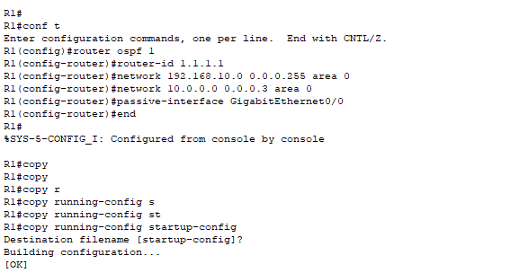

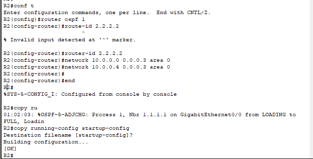

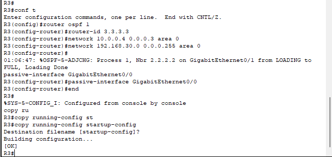

## 10. Device Configuration Evidence

The laboratory includes separate text files containing device configurations.

These files are organized under the `configs/` directory:

| Configuration File | Device |
|---|---|
| `R1.txt` | Router R1 |
| `R2.txt` | Router R2 |
| `R3.txt` | Router R3 |
| `S1.txt` | Switch configuration file |
| `S3.txt` | Switch configuration file |

These files provide a separate reference for reviewing the device configurations without opening the Packet Tracer project.

## 11. Verification and Results

Verification was conducted using Cisco IOS commands and Packet Tracer end-device tests.

### 11.1 Interface Status Verification

The command `show ip interface brief` was used to inspect interface addresses and operational states.

The interface checks confirm the addressing and status of the three routers and both switches.

**Router interface evidence:**

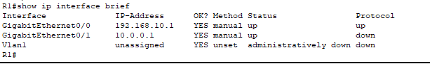

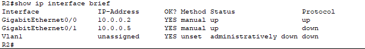

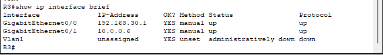

**Switch management interface evidence:**

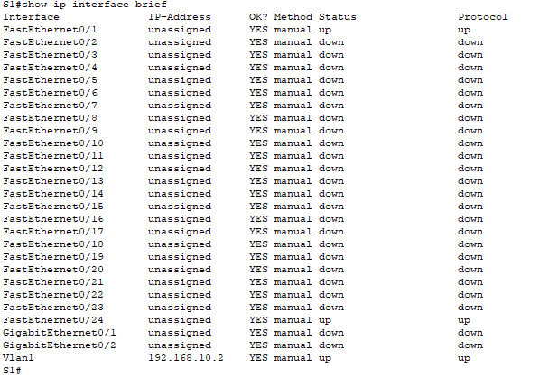

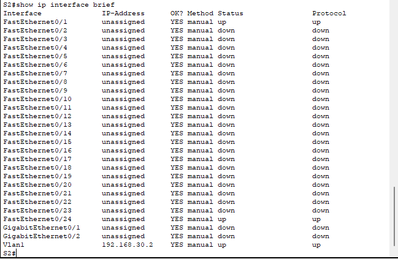

### 11.2 End-Device IP Configuration

Both end devices were configured with static IPv4 addresses and their respective default gateways.

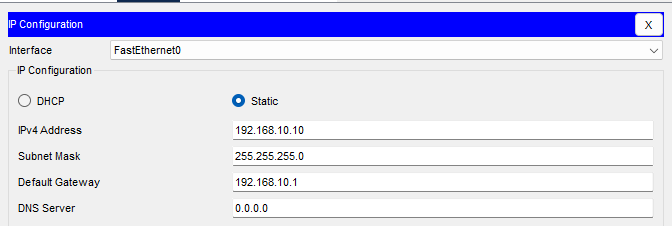

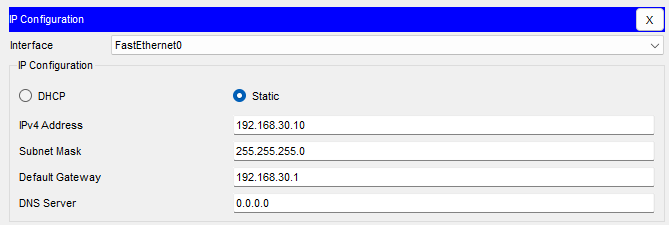

### 11.3 OSPF Neighbor Verification

The expected OSPF neighbor relationships are:

| Local Router | Expected Neighbor(s) |
|---|---|
| R1 | R2 |
| R2 | R1 and R3 |
| R3 | R2 |

All expected adjacencies reached the `FULL` state during verification.

A `FULL` state indicates that the neighboring routers have completed adjacency formation and synchronized their link-state databases.

**Neighbor verification evidence:**

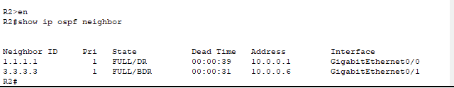

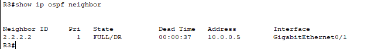

### 11.4 OSPF Routing Table Verification

OSPF-learned routes are identified by the route code `O` in the IPv4 routing table.

The following remote networks were observed:

| Router | OSPF Destination | Next Hop | Metric |
|---|---|---|---:|
| R1 | `10.0.0.4/30` | `10.0.0.2` | 2 |
| R1 | `192.168.30.0/24` | `10.0.0.2` | 3 |
| R2 | `192.168.10.0/24` | `10.0.0.1` | 2 |
| R2 | `192.168.30.0/24` | `10.0.0.6` | 2 |
| R3 | `10.0.0.0/30` | `10.0.0.5` | 2 |
| R3 | `192.168.10.0/24` | `10.0.0.5` | 3 |

These routes confirm that each router has learned the required remote networks through OSPF.

**Routing-table evidence:**

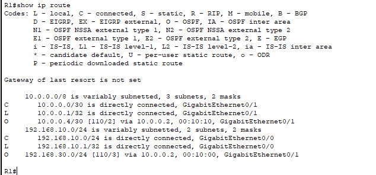

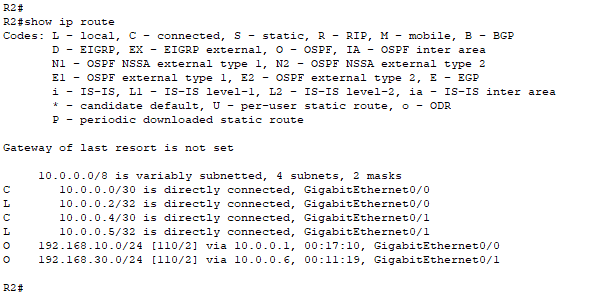

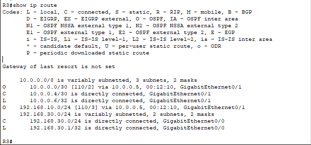

### 11.5 Final OSPF Route Verification

The command `show ip route ospf` was used on each router to display routes specifically learned through OSPF.

**R1:**

- `10.0.0.4/30` via `10.0.0.2`
- `192.168.30.0/24` via `10.0.0.2`

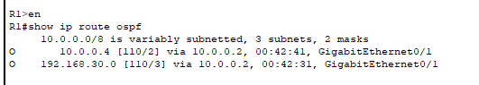

**R2:**

- `192.168.10.0/24` via `10.0.0.1`
- `192.168.30.0/24` via `10.0.0.6`

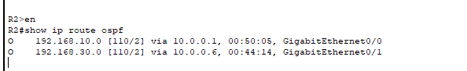

**R3:**

- `10.0.0.0/30` via `10.0.0.5`
- `192.168.10.0/24` via `10.0.0.5`

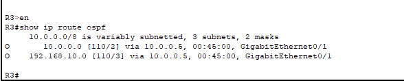

### 11.6 OSPF Interface Cost Analysis

The command `show ip ospf interface` was used to inspect the OSPF-enabled transit interfaces.

The observed interface costs were:

| Router | Inspected Interface | Observed Cost | Network Type |
|---|---|---:|---|
| R1 | GigabitEthernet0/1 | 1 | BROADCAST |
| R2 | GigabitEthernet0/0 | 1 | BROADCAST |
| R3 | GigabitEthernet0/1 | 1 | BROADCAST |

OSPF uses interface cost to calculate the total metric of a route. By default, Cisco IOS derives the cost from the reference bandwidth and interface bandwidth, subject to the configured reference bandwidth and minimum cost.

The inspected transit interfaces reported a cost of `1`.

The resulting remote-route metrics also reflect the accumulated cost across the topology.

Since this topology contains only one path between the two LANs, it does not demonstrate a cost-based choice between competing paths. A redundant topology would be necessary for that experiment.

**OSPF cost evidence:**

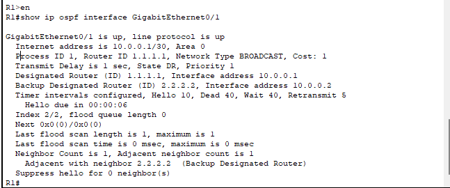

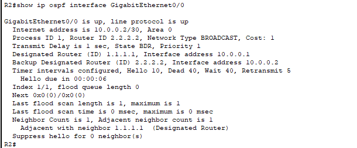

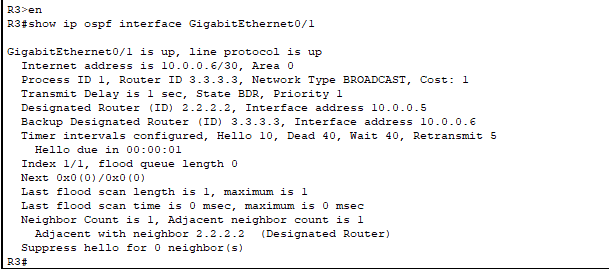

### 11.7 End-to-End Connectivity Testing

ICMP connectivity tests were performed between PC1 and PC2 in both directions.

| Source | Destination | Packets Sent | Packets Received | Packet Loss | Result |
|---|---|---:|---:|---:|---|
| PC1 (`192.168.10.10`) | PC2 (`192.168.30.10`) | 4 | 4 | 0% | PASS |
| PC2 (`192.168.30.10`) | PC1 (`192.168.10.10`) | 4 | 4 | 0% | PASS |

Both tests completed successfully with zero packet loss.

This confirms bidirectional communication between the Head Office and Branch Office LANs through the OSPF-routed network.

**Connectivity evidence:**

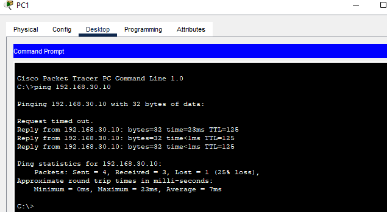

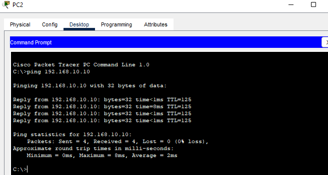

## 12. OSPF Fundamentals Covered

### Router ID

The Router ID is a 32-bit identifier used to identify an OSPF router within an OSPF routing domain.

This lab uses unique manually configured Router IDs:

- R1: `1.1.1.1`
- R2: `2.2.2.2`
- R3: `3.3.3.3`

### Neighbor Relationships

OSPF routers connected to the same network must discover compatible neighbors and establish adjacencies before exchanging link-state information.

In this topology, the expected adjacencies are R1–R2 and R2–R3.

### Route Advertisement

OSPF dynamically distributes routing information between participating routers.

Remote routes learned through OSPF are identified by the code `O` in the routing table.

### OSPF Cost

OSPF cost is used by the shortest-path calculation to evaluate routes.

The total path metric is based on the accumulated interface costs along the path. Lower-cost paths are preferred when multiple paths to a destination are available.

## 13. Useful Verification Commands

| Command | Purpose |
|---|---|
| `show ip interface brief` | Verify interface IP addresses and operational status |
| `show ip protocols` | Review routing protocol configuration |
| `show ip ospf` | Verify OSPF process information and Router ID |
| `show ip ospf neighbor` | Inspect neighbor relationships and adjacency states |
| `show ip ospf interface` | Inspect OSPF-enabled interfaces and interface costs |
| `show ip route` | Review the complete IPv4 routing table |
| `show ip route ospf` | Display OSPF-learned routes |
| `show ip ospf database` | Inspect the OSPF link-state database |
| `show running-config` | Review the active device configuration |

## 14. Troubleshooting

Common issues that may prevent successful OSPF operation include:

- Incorrect IPv4 addresses or subnet masks.
- Interfaces that are administratively down.
- Incorrect cable or interface connections.
- Duplicate Router IDs.
- Incorrect wildcard masks in OSPF network statements.
- Interfaces assigned to different OSPF areas on the same link.
- OSPF not enabled on a transit interface.
- A passive-interface command applied to a transit interface.
- Incompatible OSPF network types or Hello/Dead timers.

Useful commands for troubleshooting:

```cisco
show ip interface brief
show ip ospf
show ip ospf neighbor
show ip protocols
show ip route
show ip ospf interface
```

## 15. Security and Operational Relevance

Understanding dynamic routing is relevant to network security and infrastructure operations.

OSPF neighbor states, advertised networks, routing-table entries, and interface metrics provide visibility into the behavior of a routed network.

Unexpected neighbor relationships, unfamiliar route advertisements, duplicate Router IDs, and unexplained metric changes may indicate configuration errors or unauthorized network changes that require investigation.

This laboratory focuses on routing visibility and operational verification. It does not implement OSPF authentication or other routing-security controls.

## 16. Lessons Learned

- OSPF is a dynamic link-state routing protocol.
- Router IDs uniquely identify routers within an OSPF domain.
- OSPF neighbor adjacencies must form before routing information can be exchanged.
- Area 0 is the OSPF backbone area.
- Wildcard masks select interfaces participating in OSPF.
- Passive interfaces advertise LAN networks without forming adjacencies with end devices.
- OSPF-learned routes are identified by the code `O`.
- Interface cost contributes to the total OSPF route metric.
- Routing tables and neighbor tables are essential verification tools.
- End-to-end ICMP tests validate actual connectivity between remote networks.

## 17. Project Structure

The repository is organized to separate device configurations, laboratory observations, visual evidence, and the Packet Tracer project file.

```text
06-OSPF-Single-Area/
│
├── configs/
│   ├── R1.txt
│   ├── R2.txt
│   ├── R3.txt
│   ├── S1.txt
│   └── S3.txt
│
├── notes/
│   └── observations.md
│
├── screenshots/
│   ├── connectivity-ping-pc1-to-pc2.png
│   ├── connectivity-ping-pc2-to-pc1.png
│   ├── network-topology.png
│   ├── ospf-cost-analysis-r1.png
│   ├── ospf-cost-analysis-r2.png
│   ├── ospf-cost-analysis-r3.png
│   ├── ospf-final-routes-r1.png
│   ├── ospf-final-routes-r2.png
│   ├── ospf-final-routes-r3.png
│   ├── ospf-neighbors-r2.png
│   ├── ospf-neighbors-r3.png
│   ├── ospf-routing-table-r1.png
│   ├── ospf-routing-table-r2.png
│   ├── ospf-routing-table-r3.png
│   ├── pc1-ip-configuration.png
│   ├── pc2-ip-configuration.png
│   ├── r1-ip-interface-brief.png
│   ├── r1-ospf-configuration.png
│   ├── r2-ip-interface-brief.png
│   ├── r2-ospf-configuration.png
│   ├── r3-ip-interface-brief.png
│   ├── r3-ospf-configuration.png
│   ├── s1-ip-interface-brief.png
│   └── s2-ip-interface-brief.png
│
├── OSPF-Single-Area.pkt
└── README.md
```

### Directory Description

| Directory / File | Description |
|---|---|
| `configs/` | Text-based configuration files for the network devices |
| `notes/` | Laboratory observations and additional technical notes |
| `screenshots/` | Visual evidence of topology, configurations, verification, and connectivity tests |
| `OSPF-Single-Area.pkt` | Cisco Packet Tracer project file |
| `README.md` | Main project documentation |

The `observations.md` file contains additional laboratory notes and observations.

## 18. Future Improvements

Possible extensions for this laboratory include:

- Introduce a redundant router link and observe OSPF alternate-path selection.
- Compare route selection after modifying interface costs.
- Introduce multiple OSPF areas and study inter-area routing.
- Configure OSPF authentication where supported by the Packet Tracer IOS image.
- Apply ACLs to control communication between the two LANs.
- Investigate OSPF convergence after link failure and recovery.
- Explore routing behavior and security monitoring in a larger topology.

## 19. Technologies and Skills

### Technologies

- Cisco Packet Tracer 8.2.2
- Cisco IOS
- OSPFv2
- IPv4
- Ethernet
- Layer 2 Switching
- ICMP
- Dynamic Routing

### Skills Demonstrated

- Network topology design
- IPv4 addressing and subnetting
- Router and switch configuration
- OSPF process configuration
- Router ID assignment
- OSPF neighbor verification
- Dynamic route advertisement
- Routing-table analysis
- OSPF cost inspection
- End-to-end connectivity testing
- Network troubleshooting
- Technical documentation

---

**Lab:** 06 — OSPF Single-Area  
**Platform:** Cisco Packet Tracer 8.2.2  
**Routing Protocol:** OSPFv2  
**OSPF Process ID:** 1  
**OSPF Area:** 0  
**Topology:** Three routers, two user LANs, two transit networks
